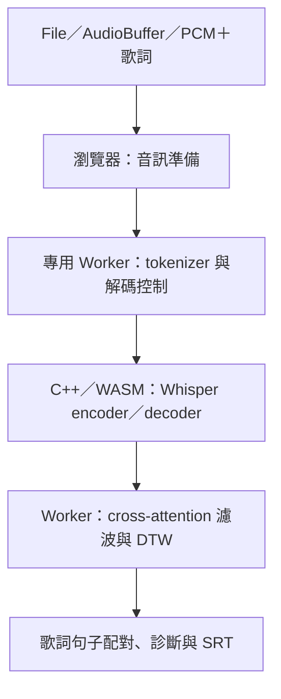

# lyric-align-ts

把歌曲音檔與已知歌詞對齊，回傳逐詞／逐句時間軸與 SRT。模型、tokenizer、解碼控制與 DTW 都在瀏覽器 Worker 中執行，網站只需要提供靜態資產，沒有 Node.js 推論伺服器。

目前分支產出實驗性 `lyric-align-ts@0.1.1` 本機套件，尚未發布。保留 fast 的 tiny Q5_1／CPU WASM 歌詞引導對齊，並提供 contract v1 的獨立 ASR／文字配對 session。句首提前、句尾偏差與零長度時間軸仍須聽校；session 的三首全曲驗證尚未達全行匹配，不能宣稱無時間碼歌曲流程可用。

## 與 yt-subtitle 整合

```ts
import { createBinding } from 'lyric-align-ts';
import type { AudioInput } from 'lyric-align-ts/binding';

const binding = createBinding(); // 不載入模型、不建立 Worker
const session = await binding.createSession();
const context = { signal: new AbortController().signal };
const audio: AudioInput = { pcm: completeMonoPcm, sampleRate: 16000 };
try {
  await session.prepare({ language: 'en' }, context);
  const segments = await session.transcribe(audio, { language: 'en' }, context);
  const result = await session.align(segments, originalLyricLines, { karaoke: false }, context);
  // 消費端驗證每行原文、matched、秒數及完整覆蓋，全部成功才原子套用。
} finally {
  await session.dispose();
}
```

本版宣告 `en/ja/zh`、`wasm`、固定 tiny Q5_1 模型、`threshold` 與 `karaoke=false`；`lyricsContext=false`，不支援 `pairing/window`。未指定語言時使用 prepare 的語言，否則預設英文。模型可搬至自架 URL，但 SHA256 固定，不因此更換模型。

根入口仍保留既有 `AudioInput`／`Progress` 型別；session 同名契約型別從 `lyric-align-ts/binding` 匯入，或在根入口使用 `ContractAudioInput`／`ContractProgress`。完整規格、消費端接線證據、歌曲限制見 [session 契約](docs/session-contract.md)。這個 tiny/WASM 分支不是其他分支的 small.en/WebGPU 發布物。

## 快速開始

先依 [開發文件](docs/development.md) 建置並產生 tarball，再於使用端安裝：

```sh
npm install ./lyric-align-ts-0.1.1.tgz
```

將安裝後的 `node_modules/lyric-align-ts/dist/` 複製到網站的 `public/lyric-align-ts/`，讓 Worker 和 WASM／tokenizer 資產有固定 URL。模型權重另外取得，預設從固定 Hugging Face revision 下載 tiny Q5_1 並驗證 SHA256；也可以設定自架的 modelUrl。

```ts
import { createAligner } from 'lyric-align-ts';

const aligner = await createAligner({
  workerUrl: '/lyric-align-ts/worker.js',
  assetBaseUrl: '/lyric-align-ts/assets/',
  threads: 8,
  onProgress: ({ stage }) => console.log(stage),
});

try {
  const result = await aligner.align({
    audio: audioFile, // File／Blob、AudioBuffer，或 16 kHz mono Float32Array
    lyrics: '第一句歌詞\n第二句歌詞',
    language: 'zh',
  });
  console.log(result.words, result.cues, result.metrics);
  const subtitle = new Blob([result.srt], { type: 'application/x-subrip' });
} finally {
  aligner.dispose();
}
```

ESM bundler 使用者應明示設定上述資產 URL；不用 bundler、直接從套件 dist/index.js 匯入時，預設從該檔相對位置載入 worker.js 與 assets/。靜態伺服器必須保留正確的 JavaScript／WASM MIME type。

## 瀏覽器條件

- 安全來源：HTTPS 或 localhost。
- 回應標頭 `Cross-Origin-Opener-Policy: same-origin` 與 `Cross-Origin-Embedder-Policy: require-corp`，令 crossOriginIsolated 為 true。
- Worker、WebAssembly、SharedArrayBuffer、Intl.Segmenter。檔案解碼／重採樣另使用 Web Audio。
- 已測桌面 Chrome。未驗證 Safari／Firefox／行動裝置，不宣稱所有瀏覽器支援。
- 跨來源模型與資產需要正確 CORS/CORP；經驗證的同來源靜態部署最容易配置。
- 原生 WASM 初始線性記憶體為 512 MiB，可增長至 2 GiB；還需模型、tokenizer 與 JavaScript 記憶體。並非低記憶體行動裝置方案。

不符合條件時會回報錯誤，不會偷偷改用 Node.js、GPU 或雲端服務。

## 公開 API

| API | 用途 |
|---|---|
| createBinding(options?) / binding | contract v1 binding，提供 capabilities 與 createSession；session 見上節 |
| createAligner(options?) | 載入並驗證模型、WASM 與 tokenizer，回傳可重用的 aligner |
| aligner.align({ audio, lyrics, language, signal?, onProgress? }) | 完整音檔對齊，回傳 words、cues、srt、audioSeconds、metrics |
| aligner.dispose() | 終止 Worker 並拒絕尚未完成的工作；可重複呼叫 |
| parseSrt(text) | 解析外部 SRT；要對齊時只把 cue.text 傳給 lyrics |
| toSrt(cues) | 輸出有有效時間區間的句子，不猜測缺漏時間 |
| timelineToCues(lines, words, audioSeconds) | 將逐詞時間軸配回提供的歌詞句子 |

lyrics 接受字串（每行一句）或字串陣列；language 必須明示，例如 en、ja、zh。PCM 輸入為 `{ samples: Float32Array, sampleRate: 16000 }`，會複製資料而不 detach 使用者的原始陣列。File／Blob 以瀏覽器支援的 codec 解碼，轉為 16 kHz 單聲道；音量不另做正規化。

options 可設定 workerUrl、assetBaseUrl、modelUrl、modelSha256、threads、signal、onProgress。模型必須與 tiny 多語架構相容，custom URL 仍須通過指定 SHA256；沒有自動辨識任意模型的功能。threads 支援 1、2、4、6、8、12，預設 8；即使 1 個運算執行緒仍需要 SharedArrayBuffer 與隔離標頭。

同一 aligner 可依序對齊多首，禁止並行呼叫。AbortSignal 取消會拒絕目前工作並要求終止計算 Worker；取消或 dispose 後需建立新實例。Chrome 對同步 WASM／pthread 的實際回收可能延後至目前片段退出，並非瞬間停止全部 CPU 工作。progress 是階段通知，不是假定準確的完成百分比。呼叫端 callback 拋錯不會中斷模型運算。

cues 保留原時間與 issues（例如 unmatched-text、zero-duration、out-of-bounds）。SRT 會省略無效／零長度句，不能因此把原時間估計說成已修正；需要完整覆蓋時先檢查 cues。參考字幕時間不進入推論。

## 技術流程



Whisper encoder 產生音訊特徵，decoder 在已知歌詞引導下前進，再利用 cross-attention 觀察文字對應的音訊位置。注意力經過正規化與濾波，DTW 找出依序前進的對應路徑，生成逐 token／詞時間軸。文字配對完整不表示句首、句尾正確。

固定 fast 組合保留 tiny Q5_1、8 個計算執行緒（owner＋7 helpers；預建 helper 池 12）、WASM SIMD、2 倍 mel 時間壓縮、128-token 歌詞推測批次、440-token 上限、詞彙子集與注意力重疊視窗。完整音訊仍保留，最後換回原時間；不是升調播放。timestamp token 解碼停用，時間由注意力路徑估計。

瀏覽器版本以直接函式／Worker 訊息取代原型的本機 HTTP RPC，Emscripten pthreads 在 Worker 中運算。英文分詞使用固定上游規則；日中分詞使用 Intl.Segmenter，已核對指定兩首日文歌與 tokenizer fixtures，但任意文字不保證與 Kuromoji／Jieba 完全相同。授權與來源見 [第三方 notices](THIRD_PARTY_NOTICES.md) 與 [來源說明](vendor/echogarden/PROVENANCE.md)。

## 專案結構

```text
src/                  TypeScript 公開 API、音訊／字幕與 browser engine
  core/               平台無關的對齊 helper
  engine/             tokenizer、原生 WASM adapter、fast 流程
vendor/echogarden/     固定版本的 browser-safe 上游方法與授權
native/               C++ bridge、運算核心、CMake 與來源鎖定
scripts/              JS／WASM 建置、靜態範例伺服器、發布驗證
  native/             可重現的 whisper.cpp 來源準備與編譯
examples/browser/     使用公開 API 的靜態範例
tests/                API、core、engine、native 回歸測試
docs/                 開發與發布文件
dist/                 產生的 ESM、Worker、型別與靜態資產（不提交 Git）
```

Node.js、pnpm、Docker 只用於開發／建置與測試。模型與歌曲不打進 npm 包；dist/、README 與授權文件才是發布內容。

## 計時

SDK 的 metrics.initializationSeconds 包含建立 Worker、模型／WASM／tokenizer 的載入與初始化；audioPreparationSeconds 為音訊解碼／準備，alignmentSeconds 為引擎對齊，cueMappingSeconds 為句子配對與 SRT 輸出。operationSeconds 包含此次 align 的音訊準備、Worker 往返與結果整理；totalSeconds = initializationSeconds + operationSeconds，不含兩次呼叫間使用者的閒置時間。

重用實例時 initializationSeconds 仍顯示該實例原本的初始化成本；比較第二首的增量耗時請看 operationSeconds。首次網路下載可能遠超過 10 秒，不以快取／預下載冒充端到端加速。

## Browser 套件完整歌曲實測

2026-10-24 已另建立「模型載入後，每首完整處理 ≤3 秒」的九次基準，採用 `operationSeconds`。三首目前均未達標，完整數字與速度波動見 [三秒對齊現況報告](docs/three-second-alignment-report.md)。以下既有表格的引擎時間與 SDK 總時間，以及後方原型比較表，均不等於本次新口徑基準。

以下使用本次重新編譯的固定 C++／WASM，在桌面 Chrome 各跑一次完整音檔。模型由本機靜態檔案載入；遠端首次下載可能更慢。SDK 總秒數包含初始化、音訊準備、Worker 往返與句子／SRT 整理，不與後方舊原型表格混用。

| 歌曲 | 引擎對齊秒 | SDK 總秒 | 排除後句首 MAE 秒 | SDK ≤10 秒 |
|---|---:|---:|---:|---|
| Amazing Grace | 4.126 | 4.787 | 0.464 | 是 |
| SUNEO-ISM | 9.709 | 10.429 | 0.225 | 否 |
| 春泥棒 | 6.922 | 7.632 | 0.432 | 是 |
| Green | 7.592 | 8.486 | 0.861 | 是 |
| Boys Will Be Bugs | 10.778 | 11.664 | 0.269 | 否 |
| Lift Every Voice and Sing | 4.409 | 5.147 | 0.664 | 是 |

六首皆完成對齊並符合原句首平均品質門檻，但本次 SDK 端到端計時有兩首超過 10 秒；不宣稱已達成六首穩定的 10 秒門檻。此為單次整曲執行，並非各三次驗收。原三首提供的歌詞 token 序列與舊 fast 逐項相同；重新編譯／browser 流程仍可能造成個別邊界差異，不宣稱時間軸逐值等價。

## 效能比較怎麼看

以下三首英文歌曲於 **2026-10-24（Asia/Taipei）** 各方案各完整測量一次，未以多次最佳值拼接。fast 沿用既有的三次量測，Echogarden 已重新使用相同的 tiny Q5_1 模型各測一次，取代先前 small Q5_1 的比較數據。模型權重、音訊、歌詞、PCM 與上游 Whisper 程式的 SHA256，以及 8 個計算執行緒設定，均已核對一致。

| 條件 | 本版預設 | echogarden |
|---|---|---|
| 實作 | fast preset，Chrome CPU／WASM | Echogarden 3.4.0，Windows CPU 原生 library |
| 模型 | 多語 tiny Q5_1 | 同一份多語 tiny Q5_1 權重 |
| 計算執行緒 | 8 | 8 |
| mel 時間壓縮 | 2 倍 | 無 |
| 解碼設定 | fast 批次推論、詞彙子集、EOS 門檻 1 | 官方解碼流程、EOS 門檻 0.9 |
| 音訊輸入 | 同一份 16 kHz、單聲道 PCM16 WAV | 同左 |
| 歌詞輸入 | 同一份純文字歌詞，不含參考時間 | 同左 |

測試 CPU：AMD Ryzen 5 3600（6 核心／12 邏輯處理器）；fast 瀏覽器為 Windows 上的 Headless Chrome 155。Echogarden 使用 `whisper.cpp-lib-windows-x64-cpu-20260720`。

耗時包含模型開啟、tokenizer 初始化與完整對齊，fast 另含 RPC；不包含音訊解碼、模型下載／傳入瀏覽器、WASM 載入、編譯、事後評分與模型釋放。**這不是首次開頁面到拿到字幕的全部等待時間。** 兩邊已控制為同一模型、輸入與執行緒數，但平台與演算法仍不同；此為同模型的完整方案比較，耗時差不能全部歸因於 C++ 核心優化。

表格定義：

- **CER ↓**：輸出文字與參考歌詞在 NFKC、大小寫與標點正規化後的字元編輯距離，除以參考字元數。兩邊都是已知歌詞引導，0% 只表示文字一致，**不代表自由聽寫零錯誤或時間軸正確**。
- **歌詞配對成功**：文字完整且符合句首有效性檢查的字幕句數；句尾另行檢查。
- **起點誤差 ≤1 秒**：相對原始 SRT 的句首絕對誤差不超過 1 秒的句數。
- **最大起點誤差¹**：全曲有效配對句的最大句首絕對誤差。下方效能表均不排除離群句。
- 參考 SRT 來自各歌曲對應的 Wikimedia Commons TimedText，尚未逐句人工聽校；這裡衡量的是相對於該字幕的差異。

## 效能測試 Lift Every Voice and Sing — U.S. Navy Band

[歌曲與來源](https://commons.wikimedia.org/wiki/File:Lift_Every_Voice_and_Sing_-_United_States_Navy_Band.webm) · [英文參考字幕](https://commons.wikimedia.org/wiki/TimedText:Lift_Every_Voice_and_Sing_-_United_States_Navy_Band.webm.en.srt) · 音訊 188.871 秒，19 句。

| 指標 | 本版預設 | echogarden |
|---|---:|---:|
| 字元錯誤率 CER ↓ | 0.00%（歌詞引導） | 0.00%（歌詞引導） |
| 歌詞配對成功 | 19/19 | 19/19 |
| 起點誤差 ≤1 秒 | 15/19 | 15/19 |
| 最大起點誤差¹ | 17.534 秒 | 17.534 秒 |
| 推論耗時 | 5.726 秒 | 11.874 秒 |
| 程序結束 | 推論完成，測試器停止伺服器 | 正常退出 |

## 效能測試 Boys Will Be Bugs — Cavetown

[歌曲與來源](https://commons.wikimedia.org/wiki/File:Boys_Will_Be_Bugs_by_Cavetown.webm) · [英文參考字幕](https://commons.wikimedia.org/wiki/TimedText:Boys_Will_Be_Bugs_by_Cavetown.webm.en.srt) · 音訊 325.388 秒，88 句。

| 指標 | 本版預設 | echogarden |
|---|---:|---:|
| 字元錯誤率 CER ↓ | 0.00%（歌詞引導） | 0.00%（歌詞引導） |
| 歌詞配對成功 | 88/88 | 88/88 |
| 起點誤差 ≤1 秒 | 79/88 | 78/88 |
| 最大起點誤差¹ | 11.400 秒 | 14.220 秒 |
| 推論耗時 | 8.915 秒 | 24.317 秒 |
| 程序結束 | 推論完成，測試器停止伺服器 | 正常退出 |

## 效能測試 Green — Cavetown

[歌曲與來源](https://commons.wikimedia.org/wiki/File:Cavetown_-_Green.webm) · [英文參考字幕](https://commons.wikimedia.org/wiki/TimedText:Cavetown_-_Green.webm.en.srt) · 音訊 270.542 秒，38 句。

| 指標 | 本版預設 | echogarden |
|---|---:|---:|
| 字元錯誤率 CER ↓ | 0.00%（歌詞引導） | 0.00%（歌詞引導） |
| 歌詞配對成功 | 38/38 | 38/38 |
| 起點誤差 ≤1 秒 | 23/38 | 30/38 |
| 最大起點誤差¹ | 11.740 秒 | 11.200 秒 |
| 推論耗時 | 7.687 秒 | 18.846 秒 |
| 程序結束 | 推論完成，測試器停止伺服器 | 正常退出 |

## 效能測試 Amazing Grace

音訊／歌詞／參考字幕：`amazing_grace/256k-16kHz-單聲道.wav`、`Original.txt`、`Original.srt`。

| 指標 | 本版預設 | echogarden |
|---|---:|---:|
| 字元錯誤率 CER ↓ | 0.00%（歌詞引導） | 0.00%（歌詞引導） |
| 歌詞配對成功 | 12/12 | 12/12 |
| 起點誤差 ≤1 秒 | 11/12 | 10/12 |
| 最大起點誤差¹ | 6.600 秒 | 6.160 秒 |
| 推論耗時 | 8.683 秒 | 6.732 秒 |
| 程序結束 | 推論完成，測試器停止伺服器 | 正常退出 |

## 效能測試 SUNEO-ISM

音訊／歌詞／參考字幕：`SUNEO-ISM/256k-16kHz-單聲道.wav`、`e1ZMmRlsaaU.txt`、`e1ZMmRlsaaU.srt`。

| 指標 | 本版預設 | echogarden |
|---|---:|---:|
| 字元錯誤率 CER ↓ | 0.00%（歌詞引導） | 0.00%（歌詞引導） |
| 歌詞配對成功 | 125/125 | 125/125 |
| 起點誤差 ≤1 秒 | 114/125 | 116/125 |
| 最大起點誤差¹ | 13.686 秒 | 13.686 秒 |
| 推論耗時 | 15.162 秒 | 27.785 秒 |
| 程序結束 | 推論完成，測試器停止伺服器 | 正常退出 |

## 效能測試 春泥棒

音訊／歌詞／參考字幕：`春泥棒/256k-16kHz-單聲道.wav`、`source.srt`、`source.srt`。

| 指標 | 本版預設 | echogarden |
|---|---:|---:|
| 字元錯誤率 CER ↓ | 0.00%（歌詞引導） | 0.00%（歌詞引導） |
| 歌詞配對成功 | 56/56 | 56/56 |
| 起點誤差 ≤1 秒 | 45/56 | 0/56 |
| 最大起點誤差¹ | 17.430 秒 | 167.884 秒 |
| 推論耗時 | 13.364 秒 | 15.226 秒 |
| 程序結束 | 推論完成，測試器停止伺服器 | 正常退出 |

春泥棒的 Echogarden tiny 結果雖然文字完整，但句首誤差 ≤1 秒為 0/56，最後一句相對參考字幕提前 167.884 秒，不能視為時間軸正確或可直接使用的字幕。CER 與文字配對率無法取代時間準確度。

¹ 最大值保留開場與其他離群值，不能拿排除後平均值解讀這一列。

本文件六首歌的同模型 Echogarden 測量均正常退出（exit code 0）。先前 small 模型的耗時與異常退出狀態不再混入上述六張表。tiny Q5_1 模型 SHA256 為 `818710568da3ca15689e31a743197b520007872ff9576237bda97bd1b469c3d7`。

署名與來源：Green 由 Robin Skinner（Cavetown）、Guy Larsen、Taha Khan 製作；Boys Will Be Bugs 音樂由 Robin Skinner 創作演出，mastering 為 Jesse Cannon，角色設計為 Emerson Dellaero；兩份來源標示 CC BY 3.0。Lift Every Voice and Sing 由 U.S. Navy Band 演出，詞為 James Weldon Johnson、曲為 J. Rosamond Johnson；來源頁標示歌詞／曲的公版狀態及美國政府職務錄音。來源檔與授權細節以各連結頁為準。

## 時間軸準確度與已知限制

原速度驗收允許每曲排除最多 `floor(句數 × 10%)` 句，無效句先占額度；剩餘句首平均絕對誤差須 ≤1 秒，耗時須 ≤10 秒，句尾不影響驗收。上述三首英文歌曲 fast 的單次結果符合這個門檻，但這不等於逐句開始、結束都準確。

以下沿用原句首排除名單檢查句尾，沒有另外挑掉句尾誤差大的句子：

| 歌曲 | 排除／總句數 | 保留句首 MAE | 同批保留句句尾 MAE | 全曲最大句尾誤差 |
|---|---:|---:|---:|---:|
| Lift Every Voice and Sing | 1/19 | 0.659 秒 | 0.933 秒 | 4.825 秒 |
| Boys Will Be Bugs | 8/88 | 0.270 秒 | 0.645 秒 | 7.960 秒 |
| Green | 3/38 | 0.861 秒 | 0.915 秒 | 8.440 秒 |

目前已確認的問題：

- 三首第一句都被 fast 放在 0 秒；參考字幕分別從 17.534、11.400、11.740 秒開始，開場空白被包進第一句。
- 句尾可能延伸進停頓，或在歌聲結束前提早截斷。
- Boys 第 87 句開始與結束同為 324.240 秒，屬於零長度字幕；它已在原句首驗收的離群額度內排除。
- 通過句首平均誤差門檻不代表每句都在 ±1 秒內；完整字幕仍須聽校。
- 跨平台張量等價、其他硬體與更廣泛曲目的穩定性，不能由這幾次量測推定。

## 建置、測試與發布準備

```sh
pnpm install --frozen-lockfile
pnpm run build:native
node scripts/native/model.mjs
pnpm run build
pnpm run typecheck
pnpm test
pnpm run test:browser
pnpm run test:package
pnpm run dev
```

詳見 [開發文件](docs/development.md) 與 [發布前檢查](docs/releasing.md)。test:package 會產生 npm tarball、獨立安裝、驗證 TypeScript 型別與真實 Chrome 的 Worker／WASM 資產路徑。prepack 不替使用者執行編譯；安裝包不需要 Node.js 執行期依賴。

單元測試與實際 WASM smoke 能驗證程式契約，不能取代歌曲聽校，也不能推定未見曲目或其他硬體的穩定性。測試器保存來源／模型／音訊雜湊與原始輸出在本機 .local/；原始歌曲、模型與編譯產物不隨 Git 提交。
