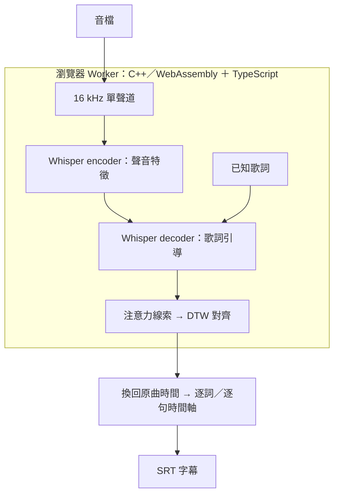

# lyric-align-ts

一首歌有聲音，一份歌詞有文字，卻不知道彼此在哪一秒相遇。

瀏覽器先把音檔轉成 16 kHz 單聲道，再把聲音與歌詞交給 Worker。裡面的 C++／WebAssembly 執行 Whisper：encoder 讀取聲音特徵，decoder 跟著已知歌詞前進，留下文字與聲音之間的注意力線索。

動態時間校正（DTW）沿著這些線索，找出歌詞依序落在音訊中的位置，再換回原曲時間、組成逐詞與逐句時間軸，輸出 SRT 字幕。推論全程在瀏覽器 CPU 完成；時間仍是估計，需要聽校。

