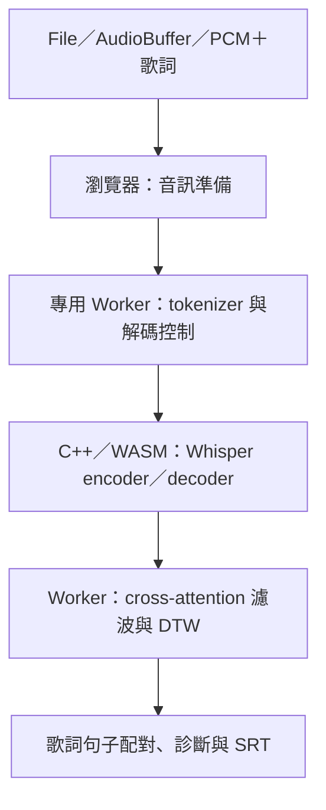

# lyric-align-ts

把歌曲音檔與已知歌詞對齊，回傳逐詞／逐句時間軸與 SRT。模型、tokenizer、解碼控制與 DTW 都在瀏覽器 Worker 中執行，網站只需要提供靜態資產，沒有 Node.js 推論伺服器。

目前分支產出實驗性 `lyric-align-ts@0.1.1` 本機套件，尚未發布。保留 fast 的 tiny Q5_1／CPU WASM 歌詞引導對齊，並提供 contract v1 的獨立 ASR／文字配對 session。句首提前、句尾偏差與零長度時間軸仍須聽校；session 的三首全曲驗證尚未達全行匹配，不能宣稱無時間碼歌曲流程可用。

## 與 yt-subtitle 整合

```ts
import { createBinding } from 'lyric-align-ts';
import type { AudioInput } from 'lyric-align-ts/binding';

const binding = createBinding(); // 不載入模型、不建立 Worker
const session = await binding.createSession();
const context = { signal: new AbortController().signal };
const audio: AudioInput = { pcm: completeMonoPcm, sampleRate: 16000 };
try {
  await session.prepare({ language: 'en' }, context);
  const segments = await session.transcribe(audio, { language: 'en' }, context);
  const result = await session.align(segments, originalLyricLines, { karaoke: false }, context);
  // 消費端驗證每行原文、matched、秒數及完整覆蓋，全部成功才原子套用。
} finally {
  await session.dispose();
}
```

本版宣告 `en/ja/zh`、`wasm`、固定 tiny Q5_1 模型、`threshold` 與 `karaoke=false`；`lyricsContext=false`，不支援 `pairing/window`。未指定語言時使用 prepare 的語言，否則預設英文。模型可搬至自架 URL，但 SHA256 固定，不因此更換模型。

根入口仍保留既有 `AudioInput`／`Progress` 型別；session 同名契約型別從 `lyric-align-ts/binding` 匯入，或在根入口使用 `ContractAudioInput`／`ContractProgress`。完整規格、消費端接線證據、歌曲限制見 [session 契約](docs/session-contract.md)。這個 tiny/WASM 分支不是其他分支的 small.en/WebGPU 發布物。

## 快速開始

先依 [開發文件](docs/development.md) 建置並產生 tarball，再於使用端安裝：

```sh
npm install ./lyric-align-ts-0.1.1.tgz
```

將安裝後的 `node_modules/lyric-align-ts/dist/` 複製到網站的 `public/lyric-align-ts/`，讓 Worker 和 WASM／tokenizer 資產有固定 URL。模型權重另外取得，預設從固定 Hugging Face revision 下載 tiny Q5_1 並驗證 SHA256；也可以設定自架的 modelUrl。

```ts
import { createAligner } from 'lyric-align-ts';

const aligner = await createAligner({
  workerUrl: '/lyric-align-ts/worker.js',
  assetBaseUrl: '/lyric-align-ts/assets/',
  threads: 8,
  onProgress: ({ stage }) => console.log(stage),
});

try {
  const result = await aligner.align({
    audio: audioFile, // File／Blob、AudioBuffer，或 16 kHz mono Float32Array
    lyrics: '第一句歌詞\n第二句歌詞',
    language: 'zh',
  });
  console.log(result.words, result.cues, result.metrics);
  const subtitle = new Blob([result.srt], { type: 'application/x-subrip' });
} finally {
  aligner.dispose();
}
```

ESM bundler 使用者應明示設定上述資產 URL；不用 bundler、直接從套件 dist/index.js 匯入時，預設從該檔相對位置載入 worker.js 與 assets/。靜態伺服器必須保留正確的 JavaScript／WASM MIME type。

## 瀏覽器條件

- 安全來源：HTTPS 或 localhost。
- 回應標頭 `Cross-Origin-Opener-Policy: same-origin` 與 `Cross-Origin-Embedder-Policy: require-corp`，令 crossOriginIsolated 為 true。
- Worker、WebAssembly、SharedArrayBuffer、Intl.Segmenter。檔案解碼／重採樣另使用 Web Audio。
- 已測桌面 Chrome。未驗證 Safari／Firefox／行動裝置，不宣稱所有瀏覽器支援。
- 跨來源模型與資產需要正確 CORS/CORP；經驗證的同來源靜態部署最容易配置。
- 原生 WASM 初始線性記憶體為 512 MiB，可增長至 2 GiB；還需模型、tokenizer 與 JavaScript 記憶體。並非低記憶體行動裝置方案。

不符合條件時會回報錯誤，不會偷偷改用 Node.js、GPU 或雲端服務。

## 公開 API

| API | 用途 |
|---|---|
| createBinding(options?) / binding | contract v1 binding，提供 capabilities 與 createSession；session 見上節 |
| createAligner(options?) | 載入並驗證模型、WASM 與 tokenizer，回傳可重用的 aligner |
| aligner.align({ audio, lyrics, language, signal?, onProgress? }) | 完整音檔對齊，回傳 words、cues、srt、audioSeconds、metrics |
| aligner.dispose() | 終止 Worker 並拒絕尚未完成的工作；可重複呼叫 |
| parseSrt(text) | 解析外部 SRT；要對齊時只把 cue.text 傳給 lyrics |
| toSrt(cues) | 輸出有有效時間區間的句子，不猜測缺漏時間 |
| timelineToCues(lines, words, audioSeconds) | 將逐詞時間軸配回提供的歌詞句子 |

lyrics 接受字串（每行一句）或字串陣列；language 必須明示，例如 en、ja、zh。PCM 輸入為 `{ samples: Float32Array, sampleRate: 16000 }`，會複製資料而不 detach 使用者的原始陣列。File／Blob 以瀏覽器支援的 codec 解碼，轉為 16 kHz 單聲道；音量不另做正規化。

options 可設定 workerUrl、assetBaseUrl、modelUrl、modelSha256、threads、signal、onProgress。模型必須與 tiny 多語架構相容，custom URL 仍須通過指定 SHA256；沒有自動辨識任意模型的功能。threads 支援 1、2、4、6、8、12，預設 8；即使 1 個運算執行緒仍需要 SharedArrayBuffer 與隔離標頭。

同一 aligner 可依序對齊多首，禁止並行呼叫。AbortSignal 取消會拒絕目前工作並要求終止計算 Worker；取消或 dispose 後需建立新實例。Chrome 對同步 WASM／pthread 的實際回收可能延後至目前片段退出，並非瞬間停止全部 CPU 工作。progress 是階段通知，不是假定準確的完成百分比。呼叫端 callback 拋錯不會中斷模型運算。

cues 保留原時間與 issues（例如 unmatched-text、zero-duration、out-of-bounds）。SRT 會省略無效／零長度句，不能因此把原時間估計說成已修正；需要完整覆蓋時先檢查 cues。參考字幕時間不進入推論。

## 技術流程



Whisper encoder 產生音訊特徵，decoder 在已知歌詞引導下前進，再利用 cross-attention 觀察文字對應的音訊位置。注意力經過正規化與濾波，DTW 找出依序前進的對應路徑，生成逐 token／詞時間軸。文字配對完整不表示句首、句尾正確。

目前預設為 tiny Q5_1、8 個計算執行緒（owner＋7 helpers；預建 helper 池 12）、WASM SIMD、3.25 倍 mel 時間壓縮、960 格音訊 context、440-token 歌詞引導批次。模型常數於初始化整理為整列量化快取，推論使用整數點積與 SIMD 函數；cross-attention 每 4 格聚合，以正規化 token／時間位置的二次懲罰係數 10 協助 DTW。最後視窗按實際剩餘長度縮短，完整 PCM 仍保留並換回原時間。timestamp token 解碼停用，時間由注意力路徑估計；參考字幕時間不進入推論。

瀏覽器版本以直接函式／Worker 訊息取代原型的本機 HTTP RPC，Emscripten pthreads 在 Worker 中運算。英文分詞使用固定上游規則；日中分詞使用 Intl.Segmenter，已核對指定兩首日文歌與 tokenizer fixtures，但任意文字不保證與 Kuromoji／Jieba 完全相同。授權與來源見 [第三方 notices](THIRD_PARTY_NOTICES.md) 與 [來源說明](vendor/echogarden/PROVENANCE.md)。

## 專案結構

```text
src/                  TypeScript 公開 API、音訊／字幕與 browser engine
  core/               平台無關的對齊 helper
  engine/             tokenizer、原生 WASM adapter、fast 流程
vendor/echogarden/     固定版本的 browser-safe 上游方法與授權
native/               C++ bridge、運算核心、CMake 與來源鎖定
scripts/              JS／WASM 建置、靜態範例伺服器、發布驗證
  native/             可重現的 whisper.cpp 來源準備與編譯
examples/browser/     使用公開 API 的靜態範例
tests/                API、core、engine、native 回歸測試
docs/                 開發與發布文件
dist/                 產生的 ESM、Worker、型別與靜態資產（不提交 Git）
```

Node.js、pnpm、Docker 只用於開發／建置與測試。模型與歌曲不打進 npm 包；dist/、README 與授權文件才是發布內容。

## 計時

SDK 的 metrics.initializationSeconds 包含建立 Worker、模型／WASM／tokenizer 的載入與初始化；audioPreparationSeconds 為音訊解碼／準備，alignmentSeconds 為引擎對齊，cueMappingSeconds 為句子配對與 SRT 輸出。operationSeconds 包含此次 align 的音訊準備、Worker 往返與結果整理；totalSeconds = initializationSeconds + operationSeconds，不含兩次呼叫間使用者的閒置時間。

重用實例時 initializationSeconds 仍顯示該實例原本的初始化成本；比較第二首的增量耗時請看 operationSeconds。首次網路下載可能遠超過 10 秒，不以快取／預下載冒充端到端加速。

## 完整歌曲驗收

本機 Windows／Chrome 155、AMD Ryzen 5 3600，模型載入後以 operationSeconds 驗收。每次從新的已初始化實例處理完整 WAV，包含音訊準備、推論、Worker 往返、句子配對與 SRT；初始化、輸入下載與事後評分另列。

三首指定歌曲各須連續完成三次獨立驗收，九次全部 ≤3 秒。每首最多排除 floor(參考句數 ×10%)，無效／缺失句先占額度，剩餘句首平均絕對誤差須 ≤1 秒；句尾不影響通過與否。這不等於每句誤差都在 ±1 秒內。

2026-10-24 合併 session 契約後重新測量，九次有八次通過。SUNEO-ISM 第一次 3.150 秒超時，不能宣稱穩定三秒達標；九次句首品質皆通過。以下未排除較慢執行。

| 歌曲 | 三次 operation 秒 | 最慢秒 | 排除／總句數 | 保留句首 MAE 秒 | 同批句尾 MAE 秒（不設門檻） |
|---|---|---:|---:|---:|---:|
| Amazing Grace | 1.215／1.215／1.423 | 1.423 | 1/12 | 0.591 | 0.971 |
| SUNEO-ISM | 3.150／2.688／2.691 | 3.150 | 12/125 | 0.970 | 1.218 |
| 春泥棒 | 2.218／2.205／2.304 | 2.304 | 5/56 | 0.277 | 1.517 |

最新逐次數字、來源／模型雜湊及重現資訊見 [效能報告](docs/three-second-alignment-report.md)。十秒切換點來回重建後為 9/9 通過，最慢 9.491 秒；兩個保留相同 API 的切換點與重建防護見 [實作相容性](docs/implementation-compatibility.md)。

句尾可能提早或延伸進停頓，開場句與零長度 cues 仍須檢查；通過平均句首門檻不能取代完整字幕聽校。三秒聲明只適用這個已知歌詞引導路徑，session 自由 ASR 的三首全曲仍未全行匹配。其他曲目、硬體與瀏覽器不宣稱同樣速度或品質。

## 建置、測試與發布準備

```sh
pnpm install --frozen-lockfile
pnpm run build:native
node scripts/native/model.mjs
pnpm run build
pnpm run typecheck
pnpm test
pnpm run test:browser
pnpm run test:package
pnpm run dev
```

詳見 [開發文件](docs/development.md) 與 [發布前檢查](docs/releasing.md)。test:package 會產生 npm tarball、獨立安裝、驗證 TypeScript 型別與真實 Chrome 的 Worker／WASM 資產路徑。prepack 不替使用者執行編譯；安裝包不需要 Node.js 執行期依賴。

單元測試與實際 WASM smoke 能驗證程式契約，不能取代歌曲聽校，也不能推定未見曲目或其他硬體的穩定性。測試器保存來源／模型／音訊雜湊與原始輸出在本機 .local/；原始歌曲、模型與編譯產物不隨 Git 提交。
